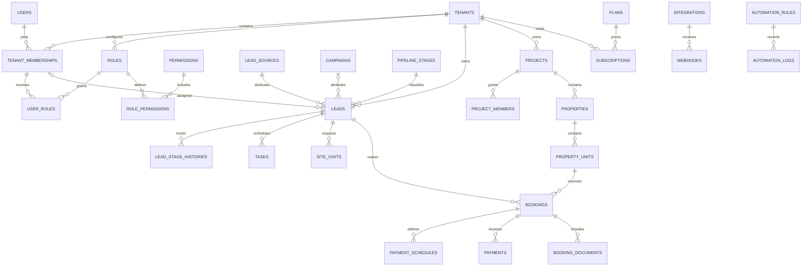

# 360BC CRM architecture

## Baseline and deployment

The workspace was empty at inspection, including no Git metadata, application, migrations or tests. The local CLI has PHP 8.5 with MySQL and SQLite PDO drivers and Node 24 with npm. Composer and a MySQL client were absent from PATH. There is no verified database server or Hostinger plan configuration.

Build a modular Laravel 13 monolith with Blade, Eloquent and MySQL/InnoDB. Compile Tailwind and ES modules with Vite. Laravel 13 requires PHP 8.3 or newer. Verify both PHP-FPM and CLI against the actual Hostinger plan before choosing the production runtime. Hostinger documents Laravel Auto Installer and Artisan cron support, but this does not establish Laravel 13 or worker support for the target account.

- [Laravel deployment requirements](https://laravel.com/framework/docs/13.x/deployment)
- [Hostinger supported frameworks](https://www.hostinger.com/support/which-programming-languages-and-frameworks-are-supported-at-hostinger/)

Verify PHP extensions, database engine and version, SSH, document root mapped to Laravel's public directory, HTTPS, cron cadence, process limits, private storage and backup restore access. Build assets outside production. Run the scheduler every minute. Use supervised queue workers when available. For a limited pilot, evaluate bounded database-queue drain jobs under a scheduler lock and measure queue delay. Move to a VPS or managed Laravel environment if the plan cannot provide safe document roots, predictable queue service, recovery or sufficient capacity.

## Application boundaries

Use Blade routes for interactive workflows, Form Requests for input validation, policies for object and row access, and domain actions for transitions involving multiple records. Keep HTTP, jobs and CLI entry points on the same domain actions. Group code by identity, sales CRM, inventory, sales operations, reporting, communications, automation and platform billing. Use ordinary Eloquent queries for CRUD. Use explicit transactions for state transitions. Queue imports, exports, notifications and provider calls after commit.

Use Blade components for shell, navigation, fields, tables, cards, dialogs, and loading and error states. Use the supplied motion PDF for visual approval and official owner artwork for logos. Tailwind tokens mirror the documented palette, Manrope and DM Sans, 14px cards and 10px controls. Alpine handles local UI state. CSS handles operational transitions. Reserve GSAP and ScrollTrigger for selected entrances and showcase content, with static reduced-motion equivalents. Use Chart.js for aggregates with a readable data equivalent and Lucide for icons. Test keyboard focus, contrast, responsive tables and mobile drawers. Keep charts and animation optional for core workflows.

## Identity and isolation

A user has one or more tenant memberships. A workspace slug or saved session choice is a selector. Resolve it against the authenticated user's active membership on each request before binding any tenant record. Reject missing, suspended or unauthorized membership. Rotate session IDs at authentication and enforce CSRF and login throttling. Owner provisioning creates the tenant, membership, default roles and initial configuration in one transaction.

Use request/job-scoped tenant context, fail-closed Eloquent tenant scopes and explicit tenant predicates for joins, reports and bulk operations. Set tenant_id from context and reject changes to it. Require tenant-scoped route binding and same-tenant lookup validation. Composite foreign keys enforce same-tenant relationships at the database boundary. Use policies for permissions and team, project, owner and assignee visibility inside the tenant. Scope cached results by tenant and actor visibility. Tenant role grants attach to memberships and role definitions belong to the same tenant. Seed Owner, Company Admin, Sales Manager, Team Leader, Telecaller and Sales Executive from configurable permission templates. Protect the last active owner. Keep platform grants and routes separate and audit privileged access.

Jobs carry tenant ID and actor identity when applicable. Rebuild context and revalidate access before reading or writing. Clear context after execution, including on exceptions. Private file downloads and completed exports go through membership and policy checks. Imports validate row references under the same context. Use explicit administrative scopes for platform-wide actions, with audit events and no implicit tenant bypass.

## Core relationships

Every tenant-owned table carries a non-null tenant_id. Keep users, permission catalog and plan catalog global. Add a unique (tenant_id, id) key where a tenant record is referenced and use composite foreign keys for tenant-owned parents. Add scoped business uniqueness such as unit code within property and event ID within provider connection. Index common queries by tenant, then status, assignment or date. Store timestamps in UTC and display in the tenant timezone. Preserve financial and audit history and apply soft deletes only where recovery is meaningful.

| Migration slice | Tables and rules |
| --- | --- |
| Foundation | tenants, users, tenant_memberships, roles, permissions, role_permissions, user_roles, platform grants, audit_logs, session and queue storage. Unique membership per user and tenant. |
| Core CRM | leads, lead_sources, campaigns, pipeline_stages, lead_stage_histories, activities, tasks, calls, projects, project_members, properties, property_units. Add teams and team membership where needed for assignment and visibility. Calendar reads from tasks and scheduled activities. |
| Sales operations | site_visits, bookings, booking_documents, documents, payments, payment_schedules, targets, import_jobs, export_jobs. Track payment amounts in integer minor units with currency. Build reports from authoritative records. |
| Integrations | messages, notifications, integrations, webhooks, automation_rules, automation_logs and an outbox for durable side effects. Keep credential values encrypted and filter secrets from logs. |
| SaaS | plans, subscriptions and billing event records. Enforce entitlements server-side and serialize quota checks that share a limit. |

## Transaction rules

- Pipeline transitions update the lead and append actor, previous stage and next stage in the same transaction. Assignment and follow-up changes append activities. Use a version check or lock for concurrent transitions.
- Booking creation locks the same unit row for each booking, cancellation or expiry path and rechecks availability under the lock. Enforce one active booking with a unique unit allocation record and preserve booking history separately. Commit inventory, booking and outbox together. Prove concurrent behavior on MySQL using independent connections.
- Keep received payments and adjustments auditable. Reconcile provider references, amounts and currencies before posting. Derive balance from confirmed payments and schedules and apply refunds through explicit adjustments.
- Verify inbound provider signatures against the raw body and check freshness where supported. Persist the event under a unique provider-connection/event key, then acknowledge and process from the durable record. Retry transient failures and log terminal failures without secrets. Use idempotency keys for provider writes. Apply deduplication and loop limits to automation.
- Publish authorization-scoped exports with expiry. Store private attachments outside the public web root, validate allowed types and sizes and audit access. Confirm consent, deletion and retention requirements before production onboarding.

## Delivery and validation gates

1. **Discovery**. Review source brief and PDF, record environment and open deployment checks, approve schema and tenancy boundaries.
2. **Foundation**. Scaffold Laravel, local setup and CI. Implement session auth, tenant provisioning and switching, membership roles, protected routes, layout and reusable tokens. Exercise two tenants, inactive membership, denied grants, switching and scoped background work before adding CRM data.
3. **Core CRM**. Implement lead intake, assignment, stage history, follow-ups, calendar and calls, projects and unit inventory. Verify the full workflow from lead creation through follow-up and test team/project restrictions.
4. **Sales operations**. Implement visits, transactional bookings, payments, private documents, targets and database-backed reporting. Test booking races on MySQL, decimal conversions, balances, attachment authorization and report totals across tenants.
5. **Automation and integrations**. Implement notification preferences, automation, email, WhatsApp, webhooks, provider adapters and job recovery. Use sandbox accounts or fixtures for repeatable integration tests and verify duplicate delivery and retry behavior.
6. **SaaS administration**. Implement plans, subscriptions, enforcement, billing lifecycle and separate platform administration. Test entitlement limits, reconciliation and privileged access with audit entries.
7. **Quality and launch**. Exercise real workflows with each role and multiple tenants, audit isolation across routes, jobs, exports and storage, and test performance with realistic datasets. Check keyboard and reduced-motion behavior. Publish deployment and troubleshooting documentation and rehearse backups, restoration and rollback on staging.

Use fast database-backed tests for routine workflows and a MySQL CI job for engine-specific foreign keys, migrations and concurrency. Keep seeded demo records explicitly labeled and outside production. Each phase report records implementation, files and migrations, executed tests, outstanding issues and prerequisites for the next phase.

## Discovery results and foundation prerequisites

Reviewed the five-page Motion Edition v2.0 PDF as the visual reference. Carry forward the 8px spacing rhythm, 16px dialog radius, keyboard focus trapping and restoration, Escape handling, and WCAG 2.2 AA verification of rendered text and control contrast. Use the original logo on a light surface or white plate unless an official reverse asset is supplied. Confirm the source artwork before integrating a logo.

Composer was absent and a connection check to getcomposer.org failed DNS resolution in this session. Dependency installation needs a reachable package source or an existing dependency cache. Provision a local MySQL instance for engine-specific verification and identify the actual Hostinger plan before validating production deployment. Discovery changed no application code or database schema and had no application tests to run.
